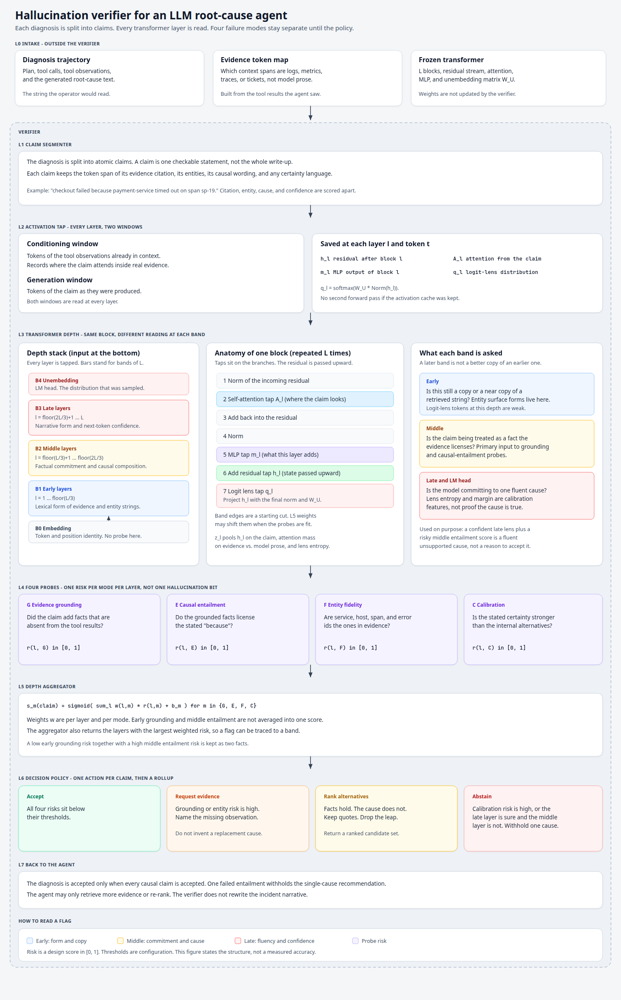

# High-Level Design

**Project:** Hallucination-Aware Verification of LLM Root-Cause Analysis Agents Using Layer-Wise Transformer Internal States

**Domain:** Artificial Intelligence

This document describes the verifier that sits beside a root-cause analysis (RCA) agent. It is a high-level design: responsibilities, data that crosses each boundary, and the reading of each transformer depth. It does not set probe weights, thresholds, or measured accuracy. Those belong to evaluation.

## 1. Purpose

An RCA agent reads logs, metrics, traces, and tickets, then names a cause. The failure this design targets is a diagnosis that is locally fluent and still causally false. The agent may quote a real log line, name a real service, and then assert a cause the observations do not support. It may also swap an identifier, or state one root cause with more certainty than the evidence allows.

Surface checks compare the finished text with retrieved documents. They miss this failure when the words overlap the evidence and the cause does not follow. The verifier instead reads the transformer state at every layer while the claim is conditioned on tool results and while the claim is generated. It scores four failure modes separately, then chooses an action.

The model that produced the diagnosis is frozen. The verifier does not fine-tune it and does not rewrite the incident narrative.

## 2. Design decisions

1. The unit of verification is an atomic claim, not the whole diagnosis.
2. Every transformer layer is tapped. Early, middle, and late bands are a starting cut, not a finding.
3. Hallucination is four scores: evidence grounding, causal entailment, entity fidelity, and calibration.
4. A confident late layer does not override a risky middle layer.
5. The only actions returned to the agent are accept, abstain, request evidence, and rank alternative causes.

Out of scope for this design: training the RCA model, tool-calling policy, and any path that has no access to hidden states. A black-box judge remains an evaluation baseline, not a component of this verifier.

## 3. Where the verifier sits

```
incident evidence --> RCA agent --> diagnosis trajectory
                                         |
                                         v
                                    verifier (L1-L7)
                                         |
                                         v
                          accept | abstain | request evidence | ranked causes
```

The agent may call tools again only when the verifier asks for a missing observation. It may re-rank causes only when the verifier rejects the causal leap and keeps the quoted facts. It does not receive permission to replace a flagged sentence with a new story of its own.

## 4. Verifier diagram

The figure below is the verifier. Section 5 explains each labeled layer in that order. Section 6 explains the transformer bands and the inside of one block, which the figure groups as L3.



The editable source of the figure is `diagrams/verifier-architecture.svg`.

## 5. Layers

### L0. Intake

L0 is outside the verifier. It supplies three inputs and does not score anything.

| Input | Contents | Used for |
| --- | --- | --- |
| Diagnosis trajectory | Plan, tool calls, tool observations, and the generated root-cause text, with token offsets | Claim spans and the generation window |
| Evidence token map | Which context spans are logs, metrics, traces, or tickets | Distinguishing retrieved evidence from the agent's own prose |
| Frozen transformer | L blocks, residual stream, attention, MLP, unembedding matrix `W_U` | The activation tap |

If a tool result never entered the context, it is not evidence for that diagnosis, even if it exists in a log store.

### L1. Claim segmenter

**Responsibility.** Split the diagnosis into atomic claims. One claim is one checkable statement.

**Input.** Diagnosis text and its token offsets.

**Output.** For each claim: the token span, any citation span, the entity strings (service, host, span, error code), the causal wording, and any certainty language.

**Does not.** Decide whether the claim is true. A citation and a cause that share a sentence are still two parts of one claim, and they are scored by different probes later.

Example shape, not a measured case: "checkout failed because payment-service timed out on span sp-19." The segmenter keeps the citation, the entities `payment-service` and `sp-19`, the causal link "because", and the certainty of the sentence.

### L2. Activation tap

**Responsibility.** Record internal state at every layer for two windows.

- **Conditioning window.** Tokens of the tool observations already in context. This is where the claim can look at real evidence.
- **Generation window.** Tokens of the claim as they were produced.

At layer `l` and token `t` the tap stores:

| Symbol | What it is |
| --- | --- |
| `h_l` | Residual stream after block `l`. This is the state passed upward. |
| `A_l` | Attention from the claim. Stored as a summary: mass on evidence spans, mass on the agent's own earlier tokens, and attention entropy. The full attention tensor is not retained. |
| `m_l` | MLP output of block `l`. What this layer adds into the residual. |
| `q_l` | Logit-lens distribution, `softmax(W_U * Norm(h_l))`. What this depth would place on the vocabulary if it were decoded with the final unembedding. |

No second forward pass is required when the cache from the generation pass was kept. The tap does not change the tokens the agent emitted.

### L3. Transformer depth

**Responsibility.** Turn the tap into one feature vector `z_l` per layer for this claim, and keep the layers grouped so a later flag can be traced to a band.

`z_l` contains: the residual pooled over the claim tokens, the residual at the last claim token, attention mass on evidence versus on model prose, MLP magnitude, and logit-lens entropy plus the margin of the token that was actually emitted.

The same block is repeated `L` times. What changes is the question asked of each band. Band edges below are the initial cut. The per-layer weights in L5 are allowed to move the effective boundary when the probes are fit. Section 6 defines the bands and the inside of one block.

### L4. Mode probes

**Responsibility.** Score four failure modes at every layer. Each probe is a linear classifier on `z_l`. There is one risk per mode per layer, `r(l, m)` in `[0, 1]`.

| Probe | Question it answers | A high risk means |
| --- | --- | --- |
| G, evidence grounding | Did the claim add facts absent from the tool results? | The claim states something the observations do not contain. |
| E, causal entailment | Do the grounded facts license the stated "because"? | The quotes may be real and the cause still does not follow. |
| F, entity fidelity | Are service, host, span, and error ids the ones in evidence? | An identifier was invented or swapped. |
| C, calibration | Is the stated certainty stronger than the internal alternatives? | The wording is more sure than the lens margin and entropy support. |

The probes do not share a single "hallucinated" label. A claim can be grounded and still fail entailment. Collapsing the four scores would hide which signal was informative at which depth.

Middle-layer features are the primary input to G and E, because that band is where factual commitment and causal composition are hypothesized to concentrate. Early-layer features are the primary input to F, because entity surface forms are still close to the retrieved strings. Late-layer lens margin and entropy are the primary input to C. Those assignments are the wiring of the design. Evaluation is what may show that a mode is readable at a different depth.

### L5. Depth aggregator

**Responsibility.** Combine per-layer risks into one score per mode, without erasing which depth produced the flag.

```
s_m(claim) = sigmoid( sum_l  w(l, m) * r(l, m) + b_m )
```

`m` is one of `{G, E, F, C}`. The weight `w(l, m)` depends on both the layer and the mode. Early grounding and middle entailment are not averaged into one bit.

The aggregator also returns the layers with the largest weighted risk. A reviewer can see whether a flag came from the middle band or only from the late band.

Disagreement is kept. A low early grounding risk together with a high middle entailment risk remains two facts. A high late-layer confidence together with a high middle entailment risk is reported as a fluent unsupported cause. It is not treated as agreement that the cause is acceptable.

### L6. Decision policy

**Responsibility.** Map the four scores to one action for the claim. Thresholds are configuration, chosen on a validation split. They are not part of the architecture.

| Action | When | What is preserved |
| --- | --- | --- |
| Accept | All four risks are below their thresholds. | The claim. |
| Request evidence | Grounding or entity risk is high. | Nothing is replaced. The action names the missing observation (log, metric, or trace). |
| Rank alternatives | Grounding and entity risk are acceptable, and entailment risk is not. | Quoted facts stay. The causal sentence is dropped. A ranked candidate set is returned. |
| Abstain | Calibration risk is high, or the late layer is confident while the middle layer's entailment risk is high. | No single root cause is recommended. |

The policy does not emit a rewritten diagnosis.

### L7. Back to the agent

**Responsibility.** Roll claims up to one diagnosis decision.

The diagnosis is accepted only when every causal claim is accepted. One failed entailment withholds the single-cause recommendation. The agent may retrieve the evidence L6 named, or it may present the ranked alternatives. It may not fill a rejected cause with a new unsupported sentence and skip the verifier.

## 6. Each transformer layer

L3 is a stack of identical blocks. Depth, not a different circuit, is what changes the reading.

### Inside one block

Information enters at the embedding and moves upward. Each block `l` does the following.

| Step | Operation | Tap | Why the verifier reads it |
| --- | --- | --- | --- |
| 1 | Normalize the incoming residual | none | Prepares the block. Not a feature by itself. |
| 2 | Self-attention | `A_l` | Where the claim looks: evidence spans versus the agent's own prose. |
| 3 | Add the attention output into the residual | none | Writes the looked-up context back into the state. |
| 4 | Normalize | none | Prepares the MLP. |
| 5 | MLP | `m_l` | What this layer adds that was not a direct copy of an earlier position. |
| 6 | Add the MLP output into the residual | `h_l` | The state passed to layer `l+1`. This is the main probe input. |
| 7 | Logit lens | `q_l` | Project `h_l` with the final norm and `W_U`. A reading of this depth, not a second decoder. |

Step 7 is the logit lens: the same unembedding the model uses at the top, applied early. Early in the stack those vocabulary projections are a weak decoder. The design uses them as a feature, and it does not treat an early top token as the diagnosis. A learned per-layer translator (a tuned lens) can replace step 7 later without moving L1, L4, L5, or L6.

### Bands

`L` is the number of blocks in the frozen model. The bars in the diagram stand for these bands. Every individual layer inside a band is still tapped.

| Band | Layers | What this depth is asked |
| --- | --- | --- |
| B0, embedding | token and position identity | Which token is present. No probe is trained here. The evidence-span index is recorded so later attention summaries have something to point at. |
| B1, early | `l = 1 ... floor(L/3)` | Is the claim still a copy or a near copy of a retrieved string? Entity surface forms are expected here. Logit-lens tokens at this depth are not trusted as the cause. |
| B2, middle | `l = floor(L/3)+1 ... floor(2L/3)` | Is the claim being treated as a fact the evidence licenses? This is the primary band for grounding and causal entailment. A sentence can match the evidence lexically in B1 and come apart here if the model composes a cause the observations do not support. |
| B3, late | `l = floor(2L/3)+1 ... L` | Is the residual being prepared as a fluent next token and a single incident story? Confidence lives here. It is not proof. |
| B4, unembedding | LM head | The distribution the agent actually sampled from. Entropy and the margin of the chosen cause token are calibration features. |

The conflict the policy is built to catch sits between B2 and B3/B4: the middle band does not support the cause, and the late band is nevertheless sure. Accepting the claim because the final token probability is high would reward the fluent failure mode this project is trying to detect.

## 7. How a claim moves through the layers

The following walk-through uses the sentence from L1 only to show which layer is responsible for which part. It is not an experimental result.

Claim: "checkout failed because payment-service timed out on span sp-19."

Suppose the tool results mention checkout errors and payment-service latency, and the only span id they contain is `sp-42`.

| Layer | What it contributes on this claim |
| --- | --- |
| L1 | Separates the latency fact, the entity `sp-19`, the word "because", and the certainty of the sentence. |
| L2 | Records attention from `sp-19` and from "because" onto the evidence tokens, at every layer. |
| L3, early | Can still look like a copy of "payment-service" and nearby latency wording. |
| L3, middle | Is the depth at which an unsupported "because", and a span id that does not match, are expected to separate from a supported statement. |
| L3, late | May still assign high probability to a single polished cause. That confidence is passed to calibration, not treated as a pass. |
| L4 | Entity fidelity can flag `sp-19`. Entailment can flag the causal link even if the service name is real. Grounding can flag a timeout if the observations only support high latency. Calibration can flag certainty that the late lens does not share. |
| L5 | Keeps those risks separate and names the layers that carried them. |
| L6 | A bad span id requests evidence or rejects the citation. A real quote with a failed entailment ranks alternatives instead of accepting one cause. |
| L7 | Withholds a single root cause for the incident while any causal claim fails. |

## 8. Contracts between layers

| From | To | Payload |
| --- | --- | --- |
| L0 | L1 | Diagnosis text, token offsets, evidence token map |
| L1 | L2 | Claim spans and the evidence spans they are allowed to use |
| L2 | L3 | `h_l`, attention summaries, `m_l`, `q_l` for each layer and window |
| L3 | L4 | `z_l` per layer, plus the band label of `l` |
| L4 | L5 | `r(l, m)` for each layer and each of G, E, F, C |
| L5 | L6 | `s_G`, `s_E`, `s_F`, `s_C`, and the top contributing layers |
| L6 | L7 | One action per claim |
| L7 | Agent | Accept the diagnosis, or abstain, or a named evidence request, or a ranked cause list |

## 9. Evaluation alignment

The design is exercised on agent trajectories from controlled microservice and distributed-system failures. A claim label comes from the injected fault and from the tool results the agent actually saw, not from the fluency of the write-up.

Reported checks, matching the project abstract:

- Which layers carry usable signal for each of the four modes.
- Whether those layers transfer across model families and incident domains.
- Whether the L6 actions reduce unsupported single-cause diagnoses while leaving supported ones in place.

Baselines that do not read internal state stay outside the verifier and are compared against it: token-level uncertainty, semantic entropy, retrieval and citation consistency, and a black-box LLM judge.

## 10. Limits

- The verifier requires hidden states. An API that returns only tokens cannot feed L2.
- Band edges are a hypothesis. Publishing them as the layers that "detect hallucination" would overclaim what this design establishes.
- Attention is summarized. A rare cross-token pattern that the summary erases will not reach the probes.
- Calibration labels are weaker than fault-injection labels for grounding and entailment, because certainty wording and lens margin are only proxies for overconfidence.
- The verifier can withhold a cause. It cannot discover a cause the agent never retrieved evidence for.
